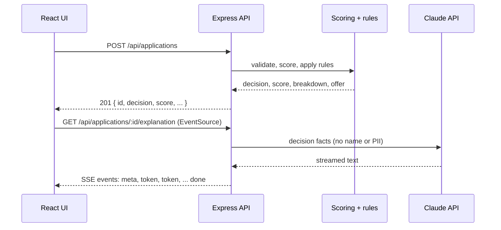

# Micro-Credit Approval Engine

A full-stack loan approval proof of concept. An Express API scores an application on a **300-900 credit scale**, runs it through a **declarative rule engine**, and returns a decision. The **Claude API** then writes a plain-language explanation of that decision, which is **streamed to the React UI over Server-Sent Events (SSE)**.

> Status: proof of concept. Data is held in memory and the scoring model is illustrative, not a production credit model.

## What it does

1. The user fills in an application (income, loan request, credit history) or loads a sample.
2. The API validates it, calculates the credit score, and applies the rules.
3. The UI shows the decision (approved, manual review, or declined), the score on a 300-900 meter, the offer if approved, how each factor contributed, and which rules passed or failed.
4. The explanation appears word by word as Claude writes it.

## Architecture



The decision comes from deterministic code, and Claude only explains it. The model never decides who gets a loan.

## Project structure

```
server/
  src/validate.js     input validation
  src/scoring.js      300-900 score model and EMI maths
  src/ruleEngine.js   declarative rules, decision, rate card
  src/explain.js      Claude streaming with an offline fallback
  src/app.js          Express routes and the SSE endpoint
  test/               unit tests (node:test)
client/
  src/api.js          axios call and EventSource wrapper
  src/components/     form, score meter, result panel, streaming explanation
```

## Credit score model

Score = 300 + the sum of six factors (600 points available), so the range is 300 to 900.

| Factor | Max points | What it looks at |
| --- | --- | --- |
| Repayment history | 200 | Missed payments in the last 24 months, past default |
| Debt burden | 150 | Existing EMIs plus the new EMI as a share of income (FOIR) |
| Length of credit history | 80 | Years of history, capped at 8 |
| Credit utilisation | 70 | Share of available credit in use |
| Employment stability | 60 | Employment type and years in current work |
| Recent enquiries | 40 | Credit enquiries in the last 6 months |

Every factor returns its points and a short note, so each score can be explained.

## Decision rules

Rules live in one array in `server/src/ruleEngine.js`. Each has an id, label, severity and a `check` function.

- **Hard rules** reject the application: age 21-65, loan ends before age 70, has income, minimum income, amount and tenure within product limits, no past default, total EMIs within 50% of income, score of at least 550.
- **Soft rules** send it to manual review: loan within 12 times monthly income, at least 1 year in current work, at most 3 recent enquiries, at most 1 missed payment.
- **Approved** means no hard failures, no soft failures, and a score of 650 or more. The interest rate (12% to 18%) comes from the score.

## API

| Method | Path | Purpose |
| --- | --- | --- |
| `POST` | `/api/applications` | Evaluate an application. Returns `400` with per-field `errors` if invalid |
| `GET` | `/api/applications/:id` | Fetch a stored result |
| `GET` | `/api/applications/:id/explanation` | SSE stream of the explanation |
| `GET` | `/api/health` | Status and whether a Claude key is configured |

SSE events: `meta` (source and model), `token` (next piece of text), `done`, `failure`.

## Run it locally

Requires Node 18.18 or later.

```bash
npm run install:all
cp server/.env.example server/.env   # then add your ANTHROPIC_API_KEY
npm run dev
```

- UI: http://localhost:5173
- API: http://localhost:5000

Without an API key the app still runs and streams a template explanation, so you can try everything offline.

## Tests

```bash
npm test
```

Covers the EMI formula, score bounds (a perfect profile scores 900), each decision path, hard and soft rule behaviour, and input validation.

## Design decisions

- **Rules in code, explanations from Claude.** Decisions stay deterministic and testable. The model only turns facts into readable language.
- **SSE instead of WebSockets.** The stream is one-way, so SSE is simpler, works over plain HTTP and reconnects natively. It is a `GET`, so a browser `EventSource` can open it directly. That is why evaluation and explanation are two separate calls.
- **Privacy.** Only decision facts are sent to Claude. The applicant's name never leaves the server.
- **Graceful fallback.** If the key is missing or the Claude call fails before the first token, the server streams a template explanation instead of breaking the UI.
- **Cancellation.** If the browser disconnects, the server aborts the in-flight Claude request.

## Limitations and next steps

- Replace the in-memory store with a database (PostgreSQL).
- Add authentication, rate limiting and an audit log of every decision.
- Calibrate the scoring weights against real repayment data.
- Add integration tests for the API and the SSE endpoint, and CI.
